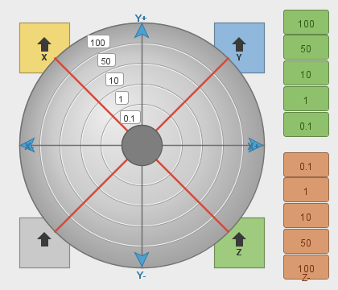

# WW Jogger

A radial **bullseye jog pad** plugin for [Universal Gcode Sender (UGS) Platform](https://universalgcodesender.com/).
Each concentric ring is a jog **step distance** and the **angle** from the centre picks the
direction — drag out from the centre and release to jog. The jog logic (fixed step set,
relative moves) is inspired by the FluidNC / ESP3D WebUI jog panel, but every move runs
through UGS's native `JogService`, so it works with any firmware UGS supports (GRBL, FluidNC,
grblHAL, Smoothie, TinyG, …).



## Features

- **Ring = step size:** `0.1 / 1 / 10 / 100` mm, inner ring to outer ring.
- **Angle = direction:** the four cardinal axes — X± and Y±. A drag toward a corner snaps to the
  nearest axis (no diagonal moves).
- **Drag to jog:** press near the centre, drag out to the ring/direction you want, release to
  send a single jog. A plain click on a cell works too. A live readout in the hub shows what
  the next move will be (e.g. `X+ 10`).
- **Centre hub = stop:** cancels an in-progress jog.
- **Z axis strip** on the right: steps `0.1 / 1 / 10` mm, small near the centre, larger towards
  the ends. Upper cells jog `Z+`, lower cells jog `Z-`.
- **Corner buttons = homing:**
  - bottom-left (plain home) → run the homing cycle (home all axes)
  - top-left `X`, top-right `Y`, bottom-right `Z` → home that single axis (sends `$HX` / `$HY` /
    `$HZ`; needs single-axis homing enabled in firmware, standard on FluidNC and most GRBL builds)
- **Separate XY and Z feed rates** (mm/min) at the bottom. The XY feed is UGS's native jog feed
  rate (shared with the rest of UGS); UGS has no Z-specific jog feed, so the Z feed is a
  plugin-local value — persisted across restarts and applied to Z jogs by scaling UGS's jog
  feed.
- Docks on startup next to the standard Jog Controller (both remain available).

## Compatibility

Works with **UGS Platform 2.0.0 and any later `2.0.0.*` build** (including the
`2.0.0.2026.9.10.18.13` stable release). The module only requires UGS Lib `>= 2.0.0`, so a
single `.nbm` installs across versions — no need for a per-version build.

## Install (prebuilt plugin)

1. Download [`dist/WW-Jogger.nbm`](dist/WW-Jogger.nbm) from this repo.
2. In UGS Platform, open **Tools → Plugins**.
3. Go to the **Downloaded** tab → **Add Plugins…** → select the `WW-Jogger.nbm` file.
4. Click **Install**, accept the prompts, and **restart UGS** when asked.
5. The **Radial Jog** panel appears automatically (also under the **Window** menu).

> The plugin is unsigned, so UGS will warn about that during install — that's expected for a
> community plugin; continue past the warning.

## Use

1. Connect to your controller as usual. The pad is disabled until UGS reports it can jog.
2. **Jog XY:** aim at a direction and a ring, then click (or drag out and release). The ring
   under the pointer sets the distance; the angle sets the direction. The hub shows the pending
   move before you release.
3. **Jog Z:** click a cell on the right-hand strip — top half is `Z+`, bottom half is `Z-`,
   distance grows towards the ends.
4. **Stop:** click the centre hub to cancel a jog.
5. **Homing:** bottom-left corner homes all axes; the `X`/`Y`/`Z` corners home that single axis
   (needs single-axis homing support in your firmware).
6. **Feed rates:** set the XY jog feed and the Z jog feed (mm/min) in the two fields at the
   bottom. The Z feed is remembered between sessions.

All distances are sent in millimetres (physically correct even if your UGS units are inches).

## Build from source

This is a NetBeans module for the UGS Platform. It builds standalone against the UGS `2.0-SNAPSHOT`
artifacts in your local Maven repository (`~/.m2`).

1. Build [UGS](https://github.com/winder/Universal-G-Code-Sender) once so its `2.0-SNAPSHOT`
   artifacts are installed in `~/.m2`. UGS 2.0 is built with **JDK 25**, so use JDK 25 here too.
2. From this repo's root, build the module:

   ```bash
   mvn package -Drevision=2.0 -Dchangelist=-SNAPSHOT -Dugs.modules.specification.version=2.0.0
   ```

3. The `.nbm` lands in `target/nbm/`.

The `-Dugs.modules.specification.version=2.0.0` flag floors the UGS Lib dependency at `>= 2.0.0`
so one `.nbm` installs across any `2.0.0.*` build.

## License

GPL-3.0 — same as Universal Gcode Sender, which this plugin builds on. See [LICENSE](LICENSE).

Not affiliated with the UGS or FluidNC projects.
