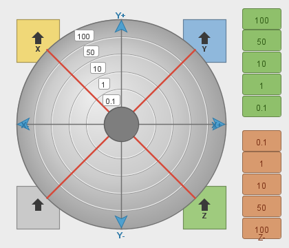

# WW Jogger

A radial **bullseye jog pad** plugin for [Universal Gcode Sender (UGS) Platform](https://universalgcodesender.com/).
Each concentric ring is a jog **step distance** and the **angle** from the centre picks the
direction — drag out from the centre and release to jog. The jog logic (fixed step set,
relative moves) is inspired by the FluidNC / ESP3D WebUI jog panel, but every move runs
through UGS's native `JogService`, so it works with any firmware UGS supports (GRBL, FluidNC,
grblHAL, Smoothie, TinyG, …).



## Features

- **Ring = step size:** `0.1 / 1 / 10 / 50 / 100` mm, inner ring to outer ring.
- **Angle = direction:** 8 directions — X±, Y± and the four diagonals (a diagonal jogs X and Y
  together by the ring distance).
- **Drag to jog:** press near the centre, drag out to the ring/direction you want, release to
  send a single jog. A plain click on a cell works too. A live readout in the hub shows what
  the next move will be (e.g. `X+Y+ 10`).
- **Centre hub = stop:** cancels an in-progress jog.
- **Z axis strip** on the right: same step distances, small near the centre, larger towards the
  ends. Upper cells jog `Z+`, lower cells jog `Z-`.
- **Corner buttons:**
  - bottom-left (plain home) → run the homing cycle (home all axes)
  - top-left `⌂X`, top-right `⌂Y`, bottom-right `⌂Z` → return that axis to its work zero
- **Feed rate** field at the bottom (UGS jog feed rate, mm/min).
- Docks on startup next to the standard Jog Controller (both remain available).

## Install (prebuilt plugin)

1. Download [`dist/WW-Jogger.nbm`](dist/WW-Jogger.nbm) from this repo.
2. In UGS Platform, open **Tools → Plugins**.
3. Go to the **Downloaded** tab → **Add Plugins…** → select the `WW-Jogger.nbm` file.
4. Click **Install**, accept the prompts, and **restart UGS** when asked.
5. The **Radial Jog** panel appears automatically (also under the **Window** menu).

> The plugin is unsigned, so UGS will warn about that during install — that's expected for a
> community plugin; continue past the warning.

## Use

1. Connect to your controller as usual. The pad is disabled until UGS reports it can jog.
2. **Jog XY:** aim at a direction and a ring, then click (or drag out and release). The ring
   under the pointer sets the distance; the angle sets the direction. The hub shows the pending
   move before you release.
3. **Jog Z:** click a cell on the right-hand strip — top half is `Z+`, bottom half is `Z-`,
   distance grows towards the ends.
4. **Stop:** click the centre hub to cancel a jog.
5. **Home / zero:** bottom-left corner homes all axes; the `X`/`Y`/`Z` corners return that axis
   to work zero.
6. **Feed rate:** set the jog feed (mm/min) in the field at the bottom.

All distances are sent in millimetres (physically correct even if your UGS units are inches).

## Build from source

This is a NetBeans module for the UGS Platform and builds as part of the UGS source tree.

1. Clone [UGS](https://github.com/winder/Universal-G-Code-Sender).
2. Drop this module in at `ugs-platform/ugs-platform-plugin-radialjog/` and add it to the
   `<modules>` list in `ugs-platform/pom.xml` (and, optionally, as a dependency in
   `ugs-platform/application/pom.xml` to bundle it into a full build).
3. Build the module (JDK 17+):

   ```bash
   ./mvnw install -pl ugs-platform/ugs-platform-plugin-radialjog -am -DskipTests
   ```

4. The `.nbm` lands in `ugs-platform/ugs-platform-plugin-radialjog/target/`.

## License

GPL-3.0 — same as Universal Gcode Sender, which this plugin builds on. See [LICENSE](LICENSE).

Not affiliated with the UGS or FluidNC projects.
